title: 实现原理

# HUTB MCP 实现原理

本页说明 MCP 智能助手的**实现原理**：分层架构、MCP 协议与 FastMCP 框架的关系、核心组件职责，
以及代码组织方式。具体功能用法见 [场景生成](scenario.md)、[路网生成](road.md)、[CARLA 执行](carla.md)。

## 1. 整体架构

系统分为四层：人机界面、FastMCP 工具层、模拟器 API 客户端、大模型服务。
用户的一句话请求，最终被拆解成若干个对 HUTB 模拟器 API 的确定性调用。

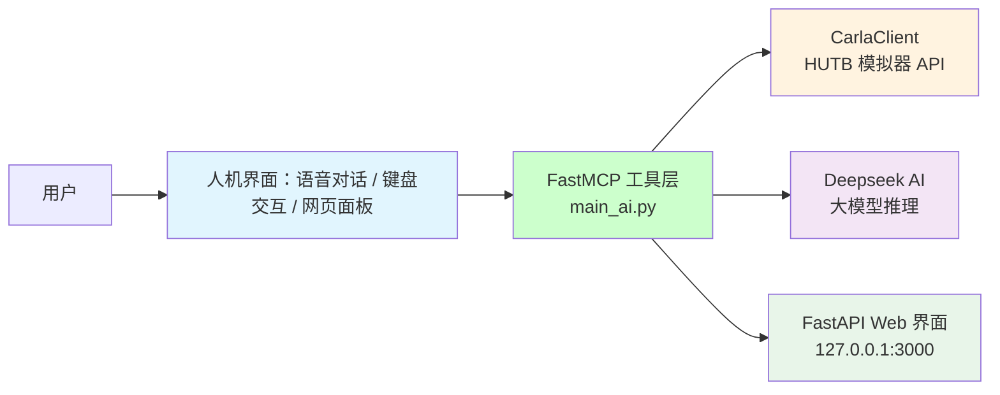

一次对话的调用时序：

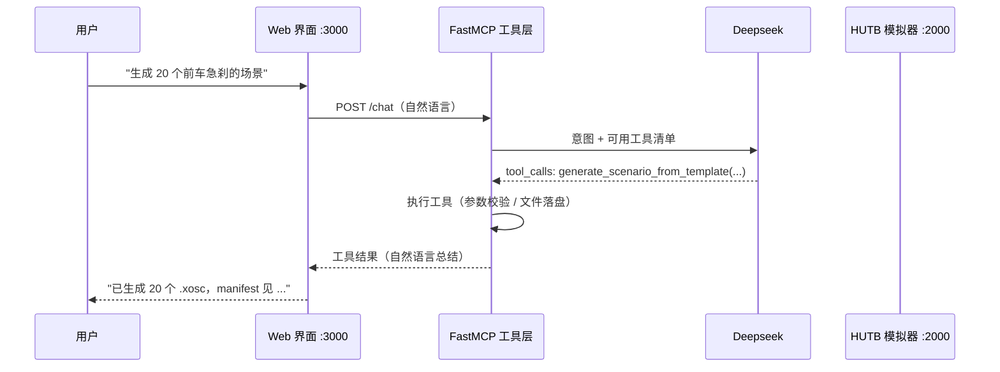

设计上有意把**大模型负责理解意图、工具负责确定性执行**这两件事分开：
大模型只做参数填充和工具选择，真正的几何计算、文件生成、CARLA 调用全部由代码完成，
因此同样的输入可以得到可复现的结果。

## 2. MCP 协议与 FastMCP

MCP（Model Context Protocol）解决的是"大模型如何知道有哪些工具可用"。
传统做法需要手写 JSON Schema 描述每个工具的参数类型、枚举值与必填项，工作量大且容易与实现脱节。

FastMCP 在 MCP 之上用装饰器做了封装，开发者只需要：

1. 写一个普通的 Python 函数；
2. 加 `@mcp.tool()` 装饰器；
3. 用类型注解（`str` / `int` / `Optional[str]` / `Literal[...]`）和 docstring 描述参数。

```python
from fastmcp import FastMCP

mcp = FastMCP("HUTB 智能助手")


@mcp.tool()
def generate_scenario_from_template(template: str, count: int = 1, seed: int = 0) -> str:
    """按模板批量生成 .xosc 场景。

    Args:
        template: 场景模板名，如 lead_brake / cut_in / crossing_hazard
        count: 生成数量
        seed: 随机种子，相同种子结果可复现
    """
    ...
```

FastMCP 自动完成的工作：

| 自动处理项 | 说明 |
|---|---|
| 工具注册 | 扫描所有 `@mcp.tool()` 函数并收集元数据 |
| JSON Schema | 由类型注解生成 MCP 协议所需的参数描述 |
| 请求路由 | 收到 `tool_call` 后分发到对应函数 |
| 错误处理 | 捕获异常并返回结构化错误，供大模型决定是否重试 |
| 结果格式化 | 返回值序列化为大模型可读文本 |

## 3. 核心组件

### 3.1 CarlaClient —— 模拟器 API 封装

`CarlaClient` 封装所有对 HUTB 模拟器的 RPC 调用，内部维护三个状态：

| 属性 | 作用 |
|---|---|
| `self.client` | `carla.Client(host, port)`，底层 RPC 客户端，超时 5 s |
| `self.world` | 世界对象，用于生成/销毁 actor、设置天气、加载地图 |
| `self.actors` | 当前会话生成的 actor 列表，便于统一清理 |

所有方法遵循"连接 → 执行 → 返回"三段式，避免长连接持有已失效的世界对象：

```python
class CarlaClient:
    def connect(self, host="localhost", port=2000):
        self.client = carla.Client(host, port)
        self.client.set_timeout(5.0)
        self.world = self.client.get_world()

    def spawn_vehicle(self, blueprint_id="vehicle.tesla.model3", ...):
        ...
```

!!! note "端口约定"
    CARLA 默认 RPC 端口为 2000。若启动时使用 `-carla-port=<port>`，客户端需对应修改。

### 3.2 FastAPI Web 界面

`main_ai.py` 同时启动一个 FastAPI 服务（默认 `127.0.0.1:3000`）：

| 路由 | 用途 |
|---|---|
| `GET /` | 对话页面 |
| `POST /chat` | 对话接口，大模型走完整工具调用流程 |
| `POST /tool` | 直接调用指定工具，供网页快捷按钮使用，**不经过大模型** |
| `GET /health` | 健康探测，`mcp.bat` 启动时轮询判断服务是否就绪 |

快捷按钮走 `/tool` 而不是 `/chat`，是为了让场景构建这类固定操作跳过推理延迟，结果也更确定。

### 3.3 环境配置

| 变量 | 用途 |
|---|---|
| `DEEPSEEK_API_KEY` | 大模型推理（必填） |
| `CARLA_HOST` | 模拟器地址，默认 `localhost` |
| `CARLA_PORT` | 模拟器 RPC 端口，默认 `2000` |
| `WEB_PORT` | Web 界面端口，默认 `3000` |

安装与启动步骤见 [环境配置](setup.md)。

## 4. 代码组织

### 4.1 仓库结构

```text
OpenHUTB/mcp/
├── mcp.bat                  # Windows 一键启动（依赖检查 → 启动 CARLA → 启动服务 → 开浏览器）
├── mkdocs.yml               # 本文档站配置
├── docs/                    # 文档源文件（本页所在目录）
├── llm/
│   ├── main_ai.py           # 核心：CarlaClient + FastMCP 工具 + FastAPI Web
│   ├── README.md            # 大模型接入说明
│   ├── check_opencv.py
│   └── src/                 # 配置、日志、辅助客户端
├── model/                   # 人形机器人模拟环境
├── sim/                     # PR2 机器人仿真集成
└── sumo/                    # SUMO 相关脚本
```

### 4.2 main_ai.py 分区

| 区块 | 职责 |
|---|---|
| 导入与路径设置 | carla / fastmcp / fastapi / aiohttp 等 |
| `CarlaClient` | 模拟器 API 封装（连接、生成、天气、视角、录制） |
| 场景与路网生成 | `.xosc` 模板渲染、`.xodr` 生成、校验 |
| FastMCP 工具定义 | 每个 `@mcp.tool()` 对应一项能力 |
| FastAPI 路由 | Web 页面、`/chat`、`/tool`、`/health` |
| 启动入口 | 解析命令行参数并启动对应服务模式 |

### 4.3 工具分类

| 类别 | 代表工具 | 文档 |
|---|---|---|
| 场景生成 | `generate_scenario_from_template`、`list_scenario_templates`、`validate_scenario` | [场景生成](scenario.md) |
| 路网生成 | `generate_rich_xodr`、`list_road_layouts` | [路网生成](road.md) |
| CARLA 执行 | `run_scenario_in_carla`、`run_road_in_carla`、`list_carla_maps` | [CARLA 执行](carla.md) |
| 轨迹合成 | `import_trajectory`、`synthesize_trajectory_dataset`、`compare_trajectory_distribution` | [轨迹合成](trajectory.md) |
| SUMO 导出 | `export_sumo_demand` | [轨迹合成](trajectory.md) |
| 基础操作 | `connect_server`、`set_weather`、`spawn_vehicle`、`switch_view`、`clean_scene` | 见对话示例 |

## 5. 运行效果

以下截图来自实际运行，左侧为 CARLA 俯视画面，右侧为 Web 对话界面。

### 5.1 对话与快捷操作

大模型理解自然语言后列出支持的路网类型，参数确认后才执行：

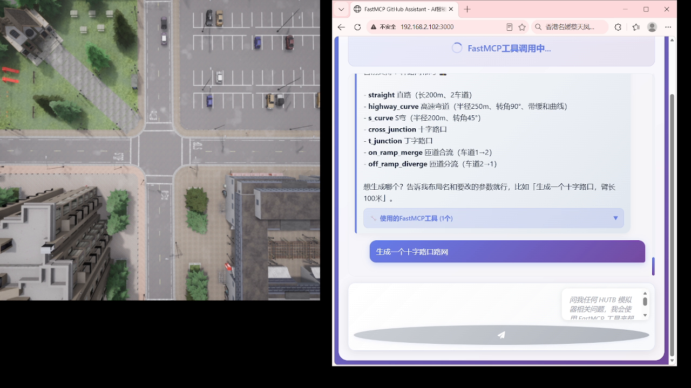

Web 界面顶部的快捷按钮面板，点击即直接执行对应场景，无需输入文字：

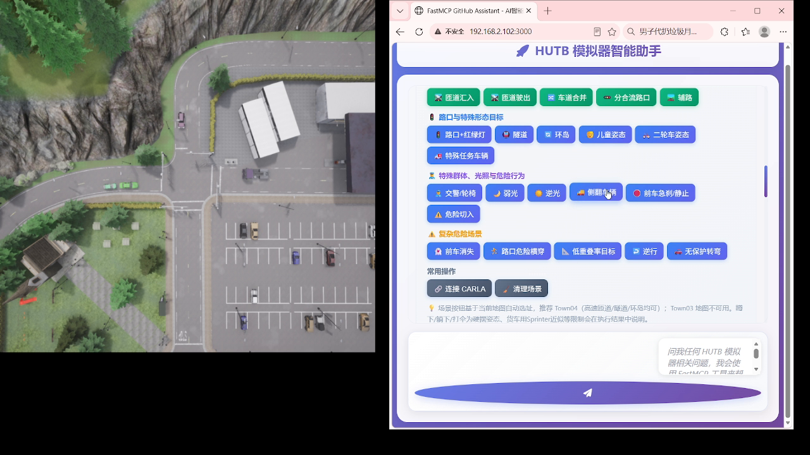

连接 CARLA 后一键构建匝道汇入场景：

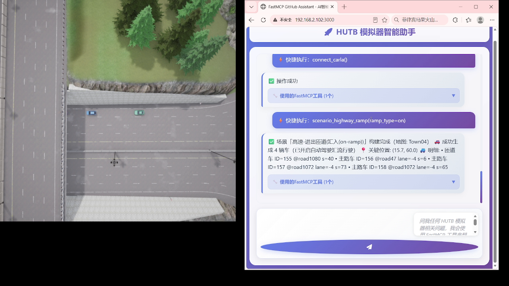

### 5.2 场景与路网

匝道驶出与隧道：

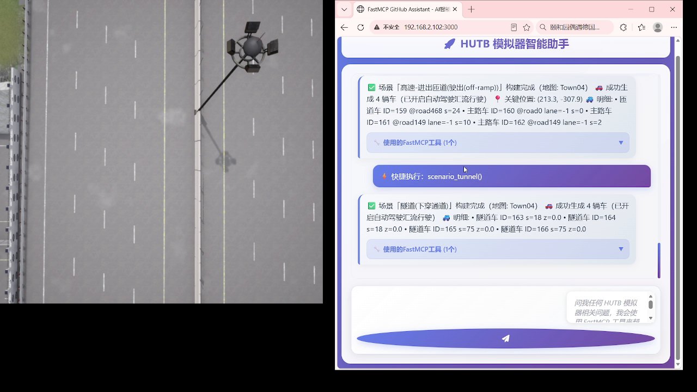

隧道与环岛：

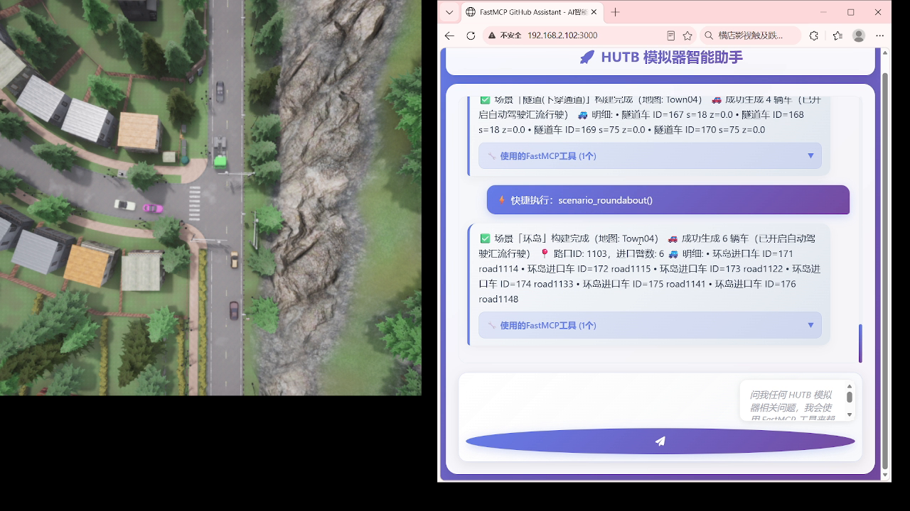

前车消失与路口危险横穿：

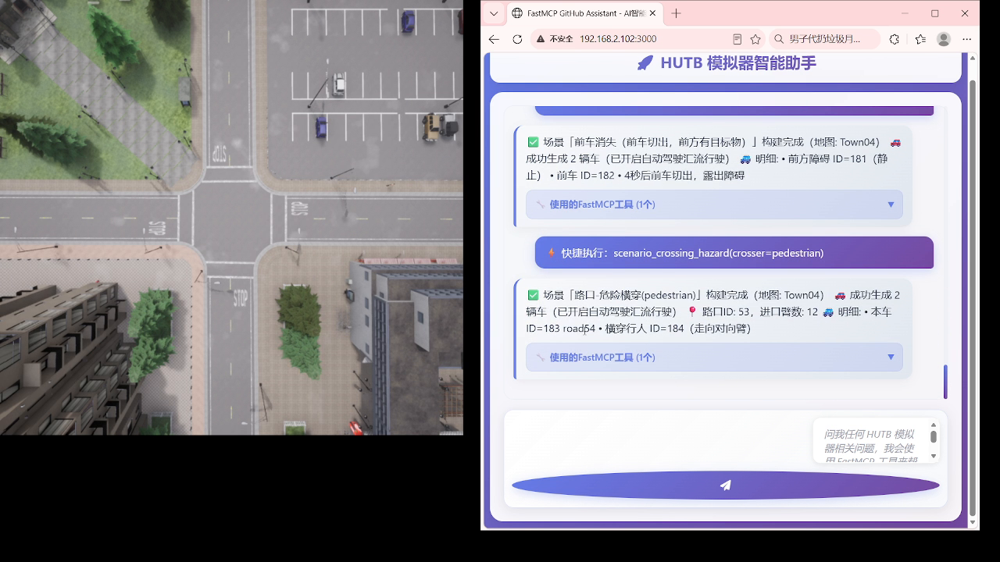

路口危险横穿与无保护转弯（返回本车、进口数、横穿行人 ID 等完整信息）：

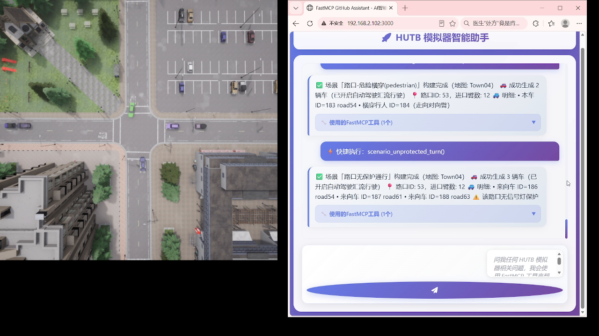

批量生成 20 个前车急刹场景，输出 `.xosc` 并附 `manifest.json` 记录每个场景参数：

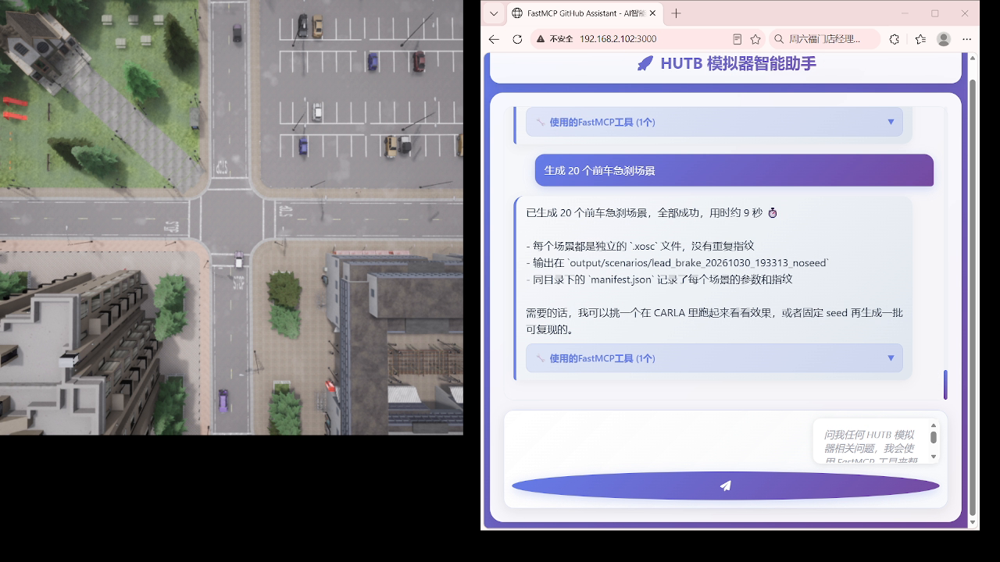

### 5.3 数据分析

MCP 工具不局限于模拟器操作，也可用于结果分析，例如对轨迹文件做分布对比：

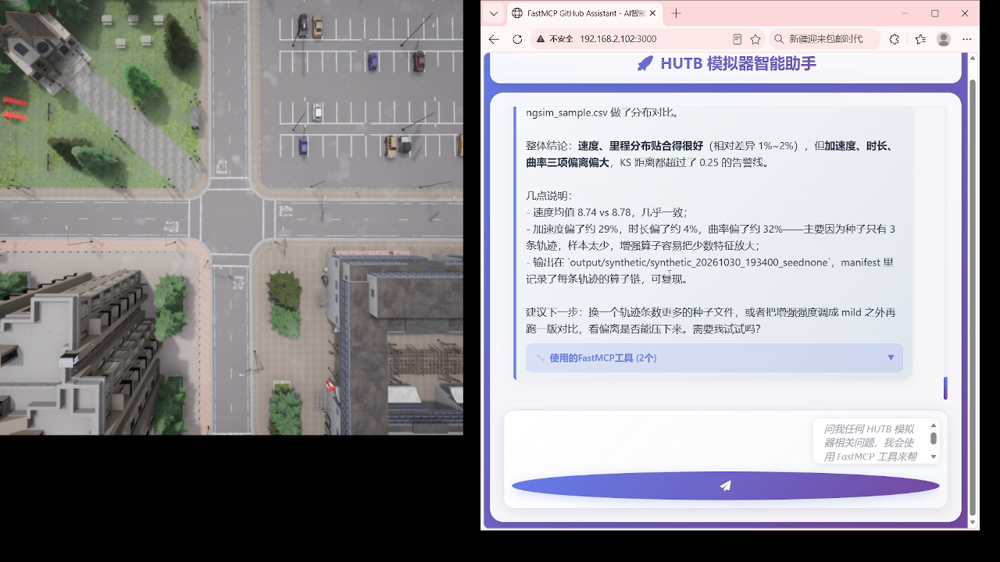

更多 CARLA 渲染效果见 [效果展示](gallery.md)。

## 6. 已知限制

工具在无法完成时会返回明确提示，不会静默失败。完整的指标与边界见 [实测数据与限制](limits.md)。

| 限制 | 说明 |
|---|---|
| 无蓝图实体 | 婴儿车、配送物流车、动物、施工车辆等在蓝图库中不存在 |
| 硬摆姿态 | 蹲下/躺下/打伞用 `set_transform` 直接设位姿，无对应动画 |
| 隧道检测 | 检测目标为桥下/下穿通道，官方地图无地质下沉隧道 |
| 运行时切图 | 会话中使用过自动驾驶后，需用目标地图重启 CARLA 再连接 |
| 地图选择 | 隧道/环岛推荐 Town04；Town03 地图包加载即崩溃，已禁用 |
