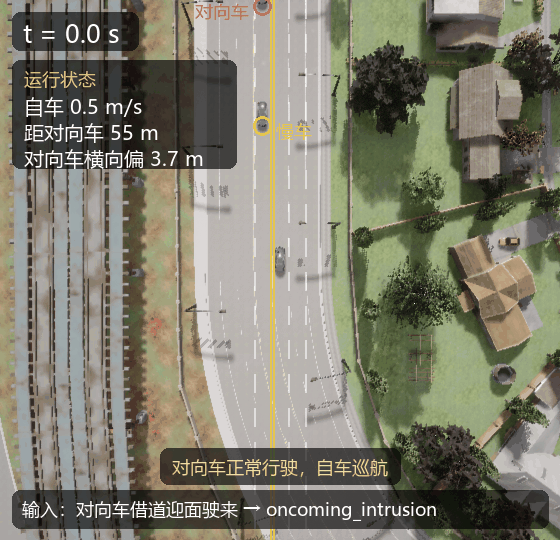
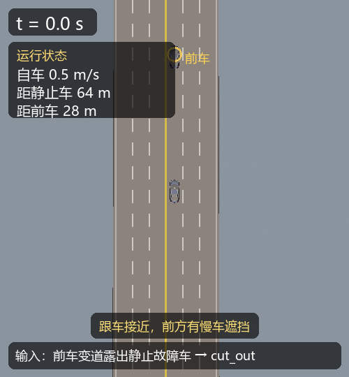
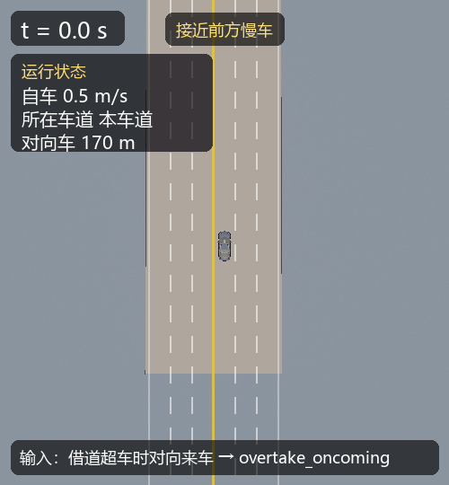
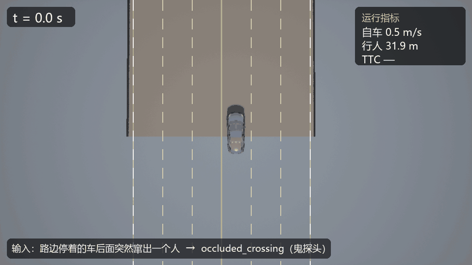
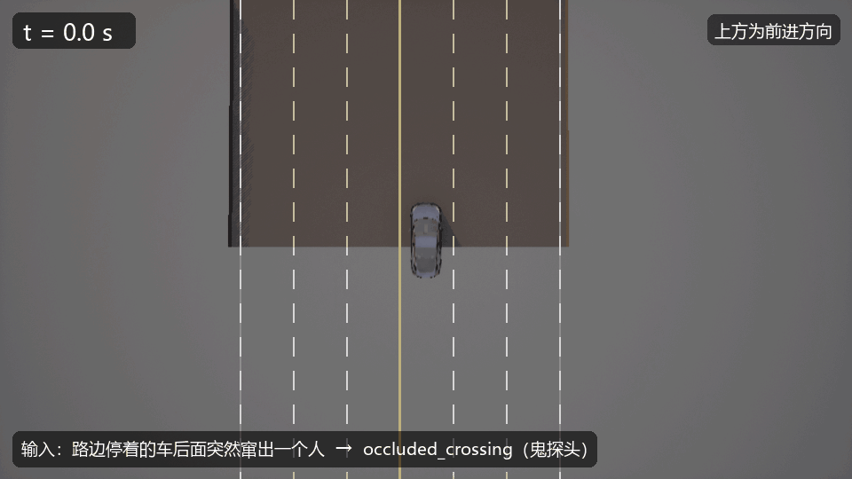
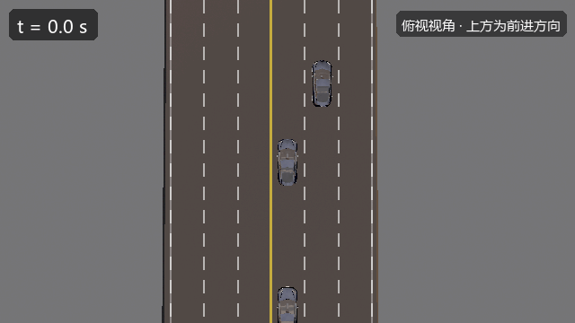

title: New Features

# New Features

按时间倒序记录新增功能。每个功能都给出：**能力说明、调用方式、示例、效果**。

图片全部使用绝对链接。

---

## 2026-11 · 对向车借道侵入本车道场景

本版新增 `oncoming_intrusion` 模板：对向车道的来车借道超越慢车，越过中心线
迎面驶入本车道；自车制动，来车在临近时退回原车道。同时修正了播放器在
城市地图上的两处问题：变道前瞻点方向、车道识别偏移。

### 1. 用法

```text
对向车借道超车，越过中心线朝我迎面开过来
对面来车占了我的车道，只能紧急刹车
对向车跑到我车道上来了
```

语义层把 `对向车借道`、`越过中心线`、`迎面占道`、`占了我的车道`
等说法路由到该模板；与借道超车相关的输入若同时含"对向车"与"借道/占道"
额外加权，避免与自车借道超车的 `overtake_oncoming` 混淆。

```python
plan_scenario("对向车借道超车，越过中心线朝我迎面开过来")
# → {"template": "oncoming_intrusion", "confidence": 1.0, ...}
```

### 2. 场景编排

城市双向路上，自车 12 m/s，对向车道一辆 12 m/s 的来车跟在 6 m/s 慢车后方。
0.5 s 时来车越过中心线驶入本车道；自车在中心距 70 m 时线性制动，
来车在 45 m 时退回原车道并减速到 5 m/s。

| 时刻 | 事件 |
|---|---|
| 0 s | 自车 12 m/s、慢车 6 m/s、对向车 12 m/s 同时布景 |
| 0.5 s | 对向车越线借道，驶入本车道 |
| 距对向车 70 m | 自车线性制动 |
| 距对向车 45 m | 对向车退回原车道并减速 |
| 约 3.6 s | 自车停车，对向车恢复原车道行驶，无碰撞 |

参数：`s0`、`road_id`、`lane`、`ego_speed`、`slow_speed`、`slow_gap`、
`oncoming_speed`、`oncoming_gap`、`lc_delay`、`lc_time`、`brake_gap`、
`brake_time`、`abort_gap`、`abort_time`、`abort_speed`，均可通过
`params_json` 覆盖。

### 3. 城市路段

模板在 `Town03` 的 `road 67`、`s0=174` 处布景。该处向前约 136 m 为直线且
无路口，`lane -1` 与对向 `+1` 均存在：

```text
run_scenario_in_carla(template="oncoming_intrusion", map_name="Town03")
```

`+1` 与 `-1` 在 OpenDRIVE 中互为左邻车道，越线与退回都用 `delta=+1`。
退回动作必须晚于越线完成，否则车辆尚未跨过中心线，播放器会按当前车道
判定，把本车道再次当作目标车道；默认参数（`lc_delay=0.5`、`lc_time=1.2`、
`abort_gap=45`）满足该约束。

### 4. 播放器修正

- **变道前瞻方向**：新增 `look_back`。对向车向负 s 方向行驶时变道，前瞻点
  必须用 `previous` 沿目标车道反向取；否则目标落在车后，纯追踪转向量恒为 0。
- **车道识别**：`Town03 road 67` 上 `get_waypoint(location)` 会把 `+1` 车道
  中心识别为 `+2`，直接取它的左邻车道会指回本车道。现在按 `(road, s)` 处
  各车道中心与车辆的实际距离重新判定（`_lane_at`）。

### 5. 效果


<div align="center"><i>oncoming_intrusion：对向车越线借道 → 自车制动 → 来车退回原车道（红圈为对向车，黄圈为慢车，11 帧）</i></div>

### 6. 实测结果

| 项目 | 结果 |
|---|---|
| 离线回归（19 个模板） | 全部通过，3 实体 / 7 事件 |
| CARLA 实跑（Town03 `road 67`） | 7 个事件全部触发：0.45 s 越线、0.80 s 制动、1.70 s 退回 |
| 碰撞 | 无 |
| 最小中心距 | 3.27 m（t=4.65 s，对向车在旁车道通过） |
| 制动减速度 | 约 4.5 m/s²（10 m/s 经 2.2 s 线性刹停） |
| 自车末速 | 0.06 m/s（已停止） |
| 语义识别 | 3 条口语描述均命中 `oncoming_intrusion` |

### 7. 已知限制

- `s0=174` 与 `road_id=67` 针对 `Town03`，换地图需重新确认直线路段与车道号。
- 退回时按固定 `abort_time` 完成变道，不随相对速度自适应；
  若把 `abort_gap` 调大到接近 `oncoming_gap`，退回会早于越线完成而失效。
- 城市路段不做路侧静态物的避让检查，调用方需自行避开停放车辆与路沿。

---

## 2026-11 · 前车切出遇静止车辆场景

本版新增 `cut_out` 模板：前车变道让出本车道，露出正前方的静止车辆，
自车按相对距离制动停车。该场景对应 AEB 的 cut-out 测试。

### 1. 用法

```text
前车突然向左变道，露出前方停着的故障车
前车切出后，本车道正前方有一辆静止车辆
```

语义层把 `前车切出`、`切出`、`变道露出`、`露出前方`、`前方停着`
等说法路由到该模板；输入同时含"变道"与"露出"或"前方"与"停着"时额外加权，
避免落到只描述前车急刹的 `lead_brake`。

```python
plan_scenario("前车突然向左变道，露出前方停着的故障车")
# → {"template": "cut_out", "confidence": 1.0, ...}
```

### 2. 场景编排

自车 50 m 处起步、12 m/s，前方 28 m 处前车 9 m/s，再往前 36 m 停着一辆静止车辆。
2.5 s 时前车向右变道让出本车道；自车与静止车中心距缩到 30 m 时线性制动到停车。

| 时刻 | 事件 |
|---|---|
| 0 s | 自车 12 m/s、前车 9 m/s、静止车 0 m/s 同时布景 |
| 2.5 s | 前车向右变道让出本车道，静止车进入视野 |
| 距静止车 30 m | 自车线性制动 |
| 约 5.9 s | 自车停在静止车前约 12 m，无碰撞 |

参数：`s0`、`road_id`、`lane`、`ego_speed`、`lead_speed`、`lead_gap`、
`stopped_gap`、`lc_delay`、`brake_gap`、`brake_time`，均可通过 `params_json` 覆盖。

### 3. 城市地图

模板默认按生成路网的 `roadId=1 / lane=-1 / s0=50` 布景。要在内置城市地图上运行，
用 `road_id`、`lane`、`s0` 指定一段同向至少两条车道、无路侧障碍的长直路：

```text
run_scenario_in_carla(template="cut_out", map_name="Town10HD_Opt",
                      params_json='{"road_id": "12", "lane": "-1", "s0": 30}')
```

相对距离按两车中心点的直线距离计算，弯道会让距离缩减得比沿路里程慢，
所以城市路段应尽量平直；路段内的静态车辆与路侧停放物需要调用方自行避开。

### 4. 效果


<div align="center"><i>cut_out：前车切出让出本车道 → 露出静止车 → 自车制动停车（红圈为静止车，黄圈为前车，10 帧）</i></div>

### 5. 实测结果

| 项目 | 结果 |
|---|---|
| 离线回归（18 个模板） | 全部通过，3 实体 / 5 事件 |
| CARLA 实跑（`wide_straight`） | 5 个事件全部触发，2.55 s 前车切出，2.85 s 触发制动，无碰撞 |
| 最小 TTC | 2.36 s（t=3.60 s，静止车） |
| 最小中心距 | 11.64 m（t=5.85 s，静止车） |
| 制动减速度 | 约 4.0 m/s²（12 m/s 经 3 s 线性刹停） |
| 自车末速 | 0.04 m/s（已停止） |
| 语义识别 | `前车切出`、`露出前方停着的故障车` 均命中 `cut_out` |

### 6. 已知限制

- 前车切出后继续以 9 m/s 行驶，会在片段后段驶过静止车辆旁侧，
  画面中两车短暂相邻，不代表冲突。
- `lead_cut_out` 的变道方向 `-1` 针对 `wide_straight` 的车道编号，
  换用其他路网或城市地图时需确认目标车道存在。
- 制动按 3 s 线性减速到 0，未接入真实 AEB 的分级触发逻辑。
- 城市地图上路段由调用方指定，模板不做路侧静态物的避让检查。

---

## 2026-11 · 借道超车遇对向来车场景

本版新增 `overtake_oncoming` 模板：自车借对向车道超越前方慢车，
对向有车驶来时放弃超车、减速并回到原车道。同时修正了播放器
"借对向车道变道后车头掉转 180°"的问题。

### 1. 用法

```text
借对向车道超车时对面有车驶来，只好放弃超车
超车到一半发现对向来车，赶紧回到原车道
```

语义层把 `超车遇对向来车`、`超车遇来车`、`放弃超车`、`对向有车驶来`
等说法路由到该模板；输入同时含"超车"和"对向"时额外加权，
避免落到只演示变道超越的 `overtake`。

```python
plan_scenario("超车到一半发现对向来车，赶紧回到原车道")
# → {"template": "overtake_oncoming", "confidence": 1.0, ...}
```

### 2. 场景编排

自车 20 m 处起步、12 m/s，前方 45 m 处慢车 7 m/s，对向车道 170 m 外
一辆 11 m/s 的车驶来。2 s 后自车借对向车道超车；双方中心距缩到 55 m 时，
自车在同一时刻触发两个动作：回到原车道、减速到 7 m/s。

| 时刻 | 事件 |
|---|---|
| 0 s | 自车 12 m/s、慢车 7 m/s、对向车 11 m/s 同时起步 |
| 2.0 s | 自车向左变道，进入对向车道开始超车 |
| 距对向车 55 m | 放弃超车：回原车道 + 线性减速 |
| 约 7.0 s | 自车回到原车道，跟在前车后方 |
| 约 7.4 s | 对向车从左侧驶过，无碰撞 |

参数：`ego_speed`、`lead_speed`、`gap`、`oncoming_speed`、`oncoming_gap`、
`lc_delay`、`abort_gap`，均可通过 `params_json` 覆盖。

### 3. 效果


<div align="center"><i>overtake_oncoming：借左车道超车 → 对向车接近 → 放弃超车回原车道（红圈为对向车，黄圈为慢车，11 帧）</i></div>

### 4. 修正：借对向车道变道后掉头

播放器变道收尾时按**目标车道**的名义朝向对齐车头。对向车道的名义朝向
与自车相差 180°，于是自车刚并到对向车道就被转成反向行驶。
现改为：目标车道朝向与变道前的行驶方向夹角超过 90° 时，保留原行驶方向，
只在同一行驶方向内做收尾对齐。本次回归中自车全程保持 +x 行驶，
不再掉头。

### 5. 实测结果

| 项目 | 结果 |
|---|---|
| 离线回归（17 个模板） | 全部通过，3 实体 / 5 事件 |
| CARLA 实跑（`wide_straight`） | 5 个事件全部触发，5.15 s 放弃超车，约 7.0 s 回到原车道，无碰撞 |
| 会车最小中心距 | 3.41 m（t=7.65 s，相邻对向车道正常会车） |
| 最大减速度 | 6.02 m/s² |
| 语义识别 | `超车遇对向来车`、`放弃超车` 均命中 `overtake_oncoming` |

### 6. 已知限制

- 播放器的 TTC 只按纵向距离与相对速度计算，不区分车道；会车瞬间
  两车横向相距 3.5 m，TTC 仍会接近 0，不代表碰撞风险。
- `abort_return` 的变道方向 `+1` 针对 `wide_straight` 的车道编号
  （+1 车道需向中心线方向回到 -1），换用其他路网时需确认车道号方向。
- 既有 `overtake` 模板的回车道动作仍用 `-1`，在该路网上会走到更外侧
  的车道；本版未改动该模板，留待单独修复。
---

## 2026-11 · 运行危险度指标

场景回放此前只给截图和事件，能看出“发生了什么”，但看不出“危险到什么程度”。
本版让播放器在结束时汇总五项指标，`summarize()` 与 `run_scenario_in_carla`
直接给出：

```text
危险度指标：
   碰撞：无
   最小中心距 3.80 m（t=5.65s，crosser）
   最小 TTC 1.41 s（t=2.65s，crosser）
   最大减速度 5.78 m/s²（t=3.65s）
   自车末速 0.04 m/s（已停止）
```

### 1. 指标口径

| 指标 | 口径 | 用途 |
|---|---|---|
| 碰撞 | 自车碰撞传感器上报，同一实体只记首次接触 | 判定是否发生事故 |
| 最小中心距 | 自车与其余实体的最小中心距离 | 衡量最近接近程度 |
| 最小 TTC | 只统计自车前方实体：纵向距离 / 接近速度 | 纵向冲突的紧迫度 |
| 最大减速度 | 帧间速度差，排除碰撞瞬间的跳变（>20 m/s²） | 制动强度 |
| 自车末速 | 结束时的速度，并给出是否已停止 | 场景是否收敛 |

### 2. 实现说明

- 碰撞用 `sensor.other.collision` 挂在自车上，回调时间取当前播放时刻；
  同一次接触会连续多帧上报，按实体去重
- 其余指标逐帧求值取全程极值。TTC 只对自车前方（纵向投影 > 0）且
  接近速度 > 0.5 m/s 的实体计算，横穿目标按其纵向距离计
- 结果放在 `play()` 返回值的 `metrics` 字段，`summarize()` 负责排版，
  MCP 工具层无需改动

### 3. 效果


<div align="center"><i>occluded_crossing：右上角实时显示自车速度、与行人的距离和 TTC，末帧汇总本次运行指标</i></div>

### 4. 实测结果

| 场景 | 结果 |
|---|---|
| `occluded_crossing` | 无碰撞，最小中心距 3.80 m，最小 TTC 1.41 s，最大减速度 5.78 m/s² |
| `cut_in_then_brake` | t=7.35 s 与 `cutter` 碰撞，最小 TTC 0.43 s |

### 5. 注意事项

- 最小中心距是质心距离，不是车身间隙；行人等小目标建议结合画面判断
- 无导航网格的生成路网里，行人被撞后会被推开，指标仍记录首次接触

---
## 2026-11 · 鬼探头场景与行人驱动

本版新增 `occluded_crossing` 模板（鬼探头），并修复横穿类场景的两个问题：
横穿者出发点无效导致布景失败、行人在生成路网中不移动。

### 1. 用法

```text
路边停着的车后面突然窜出一个人
公交车挡住视线，车头突然冒出个行人
```

语义层把 `鬼探头`、`遮挡横穿`、`盲区窜出`、`车后窜出`、`公交车遮挡`
等说法路由到该模板；输入含"鬼探头"时额外加权，避免落到 `crossing_hazard`。

```python
plan_scenario("路边停着的车后面突然窜出一个人")
# → {"template": "occluded_crossing", "confidence": 1.0, ...}
```

### 2. 场景编排

本车道前方 35 m 停放一辆遮挡视线的车，行人从该车车尾后方 3.5 m 处起步横穿；
自车匀速 8 m/s 接近，距横穿线 18 m 时线性制动至停止。

| 时刻 | 事件 |
|---|---|
| 0 s | 自车开始匀速行驶 |
| 1.5 s | 行人起步，向车道方向横穿 |
| 距横穿线 18 m | 自车线性减速 |
| — | 自车停在行人前方约 3 m |

参数：`occluder_gap`（遮挡车距离）、`lateral`（行人横向距离）、
`ped_speed`、`start_delay`、`ego_speed`，均可通过 `params_json` 覆盖。

### 3. 效果


<div align="center"><i>occluded_crossing：自车制动停止，行人从遮挡车尾横穿（红圈为行人，12 帧，0.5 秒/帧）</i></div>

### 4. 修掉的两个问题

1. **横穿者出发点无效**。原 `crossing_hazard` 把自车放在负车道弧长处，
   OpenDRIVE 不接受负的 `s`，布景直接失败；同时行人朝向为 0°，
   实际沿道路方向"平行"行走而非横穿。现改为自车从路段起点出发、
   横穿点位于前方 `ego_offset` 米处，行人朝向按横穿方向设置。
2. **行人在生成路网中不移动**。生成路网没有导航网格，
   `controller.ai.walker` 的 `go_to_location` 持续报
   `failed to set max speed`，挂上控制器后 `apply_control` 同样无效。
   现改为逐帧下发 `WalkerControl`（速度 + 当前朝向），
   实测位移与请求速度一致，不再需要速度补偿。

### 5. 实测结果

| 项目 | 结果 |
|---|---|
| 离线回归（16 个模板 + 新增条件） | 全部通过 |
| CARLA 实跑（`wide_straight`） | 3 个实体、3 个事件全部触发，自车停于行人前约 3 m，无碰撞 |
| 语义识别 | `鬼探头`、`公交车遮挡` 均命中 `occluded_crossing` |

### 6. 已知限制

- 行人在播放器里按固定朝向直线行走，不会绕开途中障碍物
- 俯视截图中行人仅约 30 px 高，动图为便于辨认加了红圈标注

---

## 2026-11 · 自然语言场景生成

此前由大模型直接编写场景脚本，存在两类问题：生成的代码无法编译，或调用不存在的接口。
本版将流程拆分为**语义解析**与**模板装配**两步：语义层只负责识别场景类型与参数，
脚本由模板库生成，可执行性由模板库保证。

### 1. 用法

直接用自然语言描述场景：

```text
旁边车加塞到我前面后立刻急刹
前方车辆突然急刹，我车速 60
有车从左侧强行并线，间距 10 米
```

需要确认匹配结果时，先调用语义解析：

```python
plan_scenario("旁边车加塞到我前面后立刻急刹")
# → {"template": "cut_in_then_brake", "confidence": 0.95, "params": {}}
```

再按模板执行：

```text
run_scenario_in_carla(template="cut_in_then_brake", xodr_layout="wide_straight")
```

### 2. 支持的表达

| 槽位 | 表达方式 | 示例 |
|---|---|---|
| 速度 | m/s、km/h、中文数字 | `60`、`60km/h`、`十五米每秒` |
| 距离 | 米、公里 | `间距 10 米`、`20m` |
| 时间 | 秒、分钟 | `3 秒后`、`两分钟` |
| 方向 | 左、右、对向 | `从左侧强行并线` |
| 参与者 | 车、行人、摩托车 | `行人横穿` |
| 数量 | 阿拉伯数字、中文数字 | `三辆车` |

当一句话同时匹配多个模板时，`find_scenario_templates(query)` 返回候选及得分；
最高分未明显领先时输出"需要澄清"，不直接选择。

### 3. 新增模板

| 模板 | 场景 | 需要地图 |
|---|---|---|
| `cut_in_then_brake` | 邻道车辆切入后制动 | — |
| `dense_lane_change` | 三车道连续变道 | — |
| `merge_turn` | 路口汇入转向 | Town10HD_Opt |

此外，`unprotected_turn` 调整为真实路口（北进口至东出口），并加入对向直行车辆。


<div align="center"><i>cut_in_then_brake：变道 → 急刹 → 追尾（画面顶部为口语输入与命中模板）</i></div>

### 4. 解决的问题

录制动图过程中发现加塞车辆未真正进入自车车道，据此定位并修复两个播放器缺陷：

1. **变道跨越两条车道**。原实现每帧重新计算相邻车道，车辆进入目标车道后目标再次外移，
   实测横向偏差 5.1 m。修复方式为在触发时刻锁定目标车道。
2. **变道结束后车辆漂移**。变道结束时车身仍存在约 15° 偏角，恢复匀速后该偏角被保留，
   车辆逐渐驶出车道。修复方式为结束时将航向对齐车道切线，并在后续保持目标车道。

### 5. 实测结果

| 项目 | 结果 |
|---|---|
| 模板离线回归 | 全部通过 |
| 中文表达识别（12 条） | 全部命中预期模板 |
| MCP 端到端（解析 → 执行） | 3 个实体、4 个事件全部触发 |
| 真实路口模板 | `unprotected_turn` / `merge_turn` 已在 Town10HD_Opt 出图 |

### 6. 输入容错

口语输入不只差在语义，也差在写法。本版新增统一的文本归一化层
（`llm/src/text_norm.py`）与打分层（`llm/src/intent_router.py`）：

| 情况 | 示例 | 处理方式 |
|---|---|---|
| 全角、繁体、语气词 | `前車突然急剎`、`麻烦帮我搞一个…` | 统一为简体，去除标点与客套话 |
| 单位写法不一 | `60码`、`六十公里每小时` | 统一换算为 km/h |
| 同义动作 | `一脚刹停`、`紧急制动` | 追加规范说法“急刹”后参与匹配 |
| 拼写略有差异 | `加塞后一脚刹停` | 用最长公共片段做近似匹配 |
| 否定表达 | `不要加塞` | 命中项被否定词过滤，返回澄清而非错误模板 |

匹配结果统一给出三档处置：`decision = execute / choose / clarify`。
置信度足够时直接执行；存在相近候选时返回候选列表供调用方点选；
无法命中时追问一句，不再落入“其他”。

同时补齐执行前校验（`llm/src/scenario_preflight.py`）：模板依赖的地图、
参数名与参数取值范围在生成和播放前检查并给出建议。此前
`generate_scenario_from_template` 会读取 `params_json` 却不生效，现已修正。

实测：18 条口语样本（含繁体、全角、语气词、同义说法）全部命中预期模板；
`不要加塞` 返回 `clarify`。

### 7. 已知限制

- 否定过滤按词面就近判断，双重否定或跨句否定仍可能误判
- 当前共 16 个模板，无法匹配时返回“未匹配”，不做猜测
- 未显式传参时取参数区间下界（如制动目标速度默认为 0，即刹停）

---

## 2026-11 · OpenSCENARIO 播放器增强：位置解析 / 新条件 / 红绿灯 / 跟驰变道

这一版补齐了播放器（`llm/src/xosc_player.py`）长期缺失的能力，并新增了
`signal_phase` 模板、一键回归脚本、网页快捷按钮和文字直达入口。

### 能力

- `LanePosition` 按 `roadId / laneId / s / offset` 正确解析（修复旧 bug）
- 新增 6 类触发条件：加速度、驶出路网、路段末端、累计里程、相对距离、相对角度
- 新增信号灯条件 `TrafficSignalCondition` 与动作 `TrafficSignalControllerAction`
- 跟驰改为 **IDM**（智能驾驶员模型），变道加 **横向加速度 3 m/s² 限幅**
- 条件求值改按 `TriggeringEntities` 选定主体（修复后车跟驰永不触发、直冲追尾）
- 新增 `run_traffic_light_demo` 工具与 `signal_phase` 模板（模板总数 11 → 12）
- 播放器按 esmini 语义解析 `ConditionGroup`（组内 AND / 组间 OR）、`Condition` 的 `delay`、
  参数声明、`Story/Act/Sequence` 与多 `Actor`、`RelativeTargetSpeed`
- `StopTrigger` 与 `StartTrigger` 同语义，满足即提前结束；速度曲线新增
  `cubic` / `sinusoidal` 与 `rate` 维度，跟驰支持 `maxAcceleration` / `maxDeceleration`
- 网页支持**文字直达**：在对话框输入快捷按钮同名文字即可执行同一场景，本地匹配、不依赖大模型
- 新增一键回归脚本 `llm/tools/run_regression.py`

### 1. `LanePosition` 解析修复

**之前的问题**：播放器把 `s` 和 `offset` 当成世界坐标 `x / y`，去最近路点里找，
只要场景不是沿 x 轴铺的，车就会布到错误位置（甚至路外）。

**现在**：先用 CARLA 的 `get_waypoint_xodr(roadId, laneId, s)` 精确解析，
再按 OSC 约定沿车道左法向叠加 `offset`；解析失败才退化为"同车道里 s 最近"。
同时 `run_scenario_in_carla` 增加了 `map_name` 参数，可以直接把场景放到
`Town03` 等内置地图上（内置地图才有真实的红绿灯）。

```text
run_scenario_in_carla(template="signal_phase", map_name="Town03")
```

### 2. 新增 6 类触发条件

| 条件 | 语义 | 实现 |
|---|---|---|
| `AccelerationCondition` | 自身加速度过阈值 | `get_acceleration()` 模长 |
| `OffroadCondition` | 连续驶出路网 | 非道路路点判定 + 持续计时 |
| `EndOfRoadCondition` | 到达路段末端 | 沿车道向前探测剩余距离 |
| `TraveledDistanceCondition` | 累计里程 | 逐帧累计位移 |
| `RelativeDistanceCondition` | 与参照实体距离 | 实体间直线距离 |
| `RelativeAngleCondition` | 与参照实体航向夹角 | 航向差（自动抬到 OSC 1.3 导出） |

生成侧同步支持：`scenario_ir` 增加对应 `TriggerKind`，`osc_builder` 负责
编译成标准 XML，回读播放器时 `unsupported` 仍为 0。

```python
TriggerSpec(kind=TriggerKind.RELATIVE_DISTANCE, entity_ref="lead", value=15.0)
TriggerSpec(kind=TriggerKind.TRAVELED_DISTANCE, value=30.0)
```

### 3. 红绿灯相位控制

- 条件：取**自车前方最近的一盏红绿灯**的实际状态，与目标相位比较
  （支持 `Red / 红 / 红灯` 等别名）
- 动作：冻结信号灯并切换到指定相位（`green / yellow / red / off`）

新增工具 `run_traffic_light_demo`：在地图里挑一盏灯，沿来车方向后退 35m
布设自车，先冻结为红灯，到点切绿，自车按绿灯条件起步。

```text
run_traffic_light_demo(map_name="Town03", red_hold=4, capture_times="1,3,7,12")
```

实测输出（Town03）：

```text
t=0.05s  force_red   traffic_light
t=0.05s  hold_red    speed=0.00
t=4.05s  force_green traffic_light
t=4.10s  go_green    speed=8.00
```

红灯期间自车停在停止线前，切绿后通过路口：


模板 `signal_phase` 则把同一套逻辑放进可复现的 `.xosc`，可直接在内置地图上跑：

```text
run_scenario_in_carla(template="signal_phase", map_name="Town03")
```


### 4. IDM 跟驰与横向加速度约束

跟驰从 P 控制换成 IDM：

$$
\begin{aligned}
a &= a_{\max} \left[1 - \left(\frac{v}{v_0}\right)^4 - \left(\frac{s^*}{\mathrm{gap}}\right)^2\right] \\
s^* &= s_0 + \max\left(0, vT + \frac{v\Delta v}{2\sqrt{a_{\max}\,b}}\right)
\end{aligned}
$$

其中 \(a_{\max}=2.0\,\mathrm{m/s^2}\)、\(b=3.0\,\mathrm{m/s^2}\)、\(T=1.2\,\mathrm{s}\)，
\(s_0\) 取动作里的跟驰距离（`LongitudinalDistanceAction.distance`，上限 40m），
油门/刹车由期望加速度映射得到。前车急刹时自车先强减速，最终稳定在给定间距上：
`lead_brake` 的 `distance=15 m`，自车停在约 20 m 中心距（15 m 净距），后车同样按 IDM 跟驰：


<div align="center"><i>lead_brake t=15.0 s：前车已停，自车与后车都保持各自跟驰间距</i></div>

变道时按 \(a_y = v^2 \kappa \le 3\,\mathrm{m/s^2}\) 对转向做限幅
（\(\kappa \approx 0.12 \cdot \mathrm{steer}\)），高速下的切入不再出现"瞬间横甩"：


### 5. 一键回归脚本与网页快捷按钮

`llm/tools/run_regression.py` 默认做离线回归（12 个模板 + 新增条件合成场景），
加 `--carla` 直接连 CARLA 实跑：

```text
python llm/tools/run_regression.py
python llm/tools/run_regression.py --carla --duration 5
```

实测：离线 **12/12** 模板结构校验通过、`unsupported=0`；CARLA 实跑
11 个依赖自建路网的模板全部布景成功、无错误（`signal_phase` 需内置地图，
由 `run_traffic_light_demo` 覆盖）。

网页端 `http://127.0.0.1:3000/` 的"场景快捷按钮"面板顶部新增了
**2026-11 新增功能** 分组，四个按钮分别对应红绿灯演示、红绿灯模板、
IDM 跟驰与变道限幅，点击即可执行并回显截图路径。
面板上的按钮也可以改用文字触发（见第 7 节）。

### 6. 播放器语义对齐（参照 esmini）

此前播放器只取每个事件里的**第一条**条件，`ConditionGroup` 的 AND/OR 语义、
`delay`、参数声明都被忽略。这一版按
[esmini](https://github.com/esmini/esmini) 的求值方式补齐：

| OSC 结构 | 现在的行为 |
|---|---|
| 多个 `ConditionGroup` | 组之间 OR |
| 组内多个 `Condition` | AND；每个叶子独立做 `conditionEdge` 判边沿 |
| `Condition` 的 `delay` 属性 | 条件需连续成立 N 秒才触发 |
| `ParameterDeclarations` | `$name` / `${name}` 在解析前静态替换 |
| `Story / Act / Sequence` | 全层级遍历（之前只认 `Story/Act/ManeuverGroup`） |
| 一个 `ManeuverGroup` 多个 `Actor` | 每个 Actor 各展开一份事件 |
| `RelativeTargetSpeed` | 支持 `delta`（参照速度 + 值）与 `factor`（参照速度 × 值） |

回归脚本新增 `conformance` 用例：构造含 2 个 ConditionGroup、`delay=2`、
`$brake_target` 参数、Sequence 嵌套、双 Actor 与 `RelativeTargetSpeed factor`
的 `.xosc`，逐项断言解析结果：

```text
✅ conformance  条件组 AND/OR、delay、参数、多 Actor、相对速度全部生效
```

### 7. 文字直达场景（无需大模型）

在网页聊天框输入快捷按钮上的文字，会先命中本地意图表，直接调用同一个工具并
回显截图路径。匹配与执行都在本机完成，不依赖 DeepSeek API Key 或网络。

| 输入文字 | 执行的操作 |
|---|---|
| `IDM 跟驰` / `前车急刹跟驰` / `跟驰场景` | `run_scenario_in_carla(template="lead_brake", duration=18)` |
| `红绿灯相位演示` / `信号灯演示` | `run_traffic_light_demo(map_name="Town03")` |
| `红绿灯模板` / `红绿灯场景` | `run_scenario_in_carla(template="signal_phase", map_name="Town03")` |
| `横向加速度` / `变道约束` | `run_scenario_in_carla(template="cut_in")` |
| `播放 lead_brake 模板` | 按模板英文名直接播放 |
| `隧道` / `环岛` / `匝道汇入` / `无保护转弯` … | 对应的原有 `scenario_*` 工具 |

文字里还能带参数（地图、时长、截图时刻、红灯时长）：

```text
IDM 跟驰，截图 6,12,15
在 Town04 跑匝道汇入
红绿灯相位演示，红灯 8 秒
```

输入“IDM 跟驰”后的实际界面与结果：


<div align="center"><i>输入按钮同名文字即可执行，结果回显触发事件与截图路径</i></div>

### 8. 停止触发、速度曲线与跟驰限幅

**停止触发**：此前 `StopTrigger` 只认第一条 `SimulationTimeCondition`，场景只能跑满
固定时长。现在它与 `StartTrigger` 走同一套求值逻辑——组间 OR、组内 AND、
`TriggeringEntities` 主体、`conditionEdge` 边沿，满足即提前结束：

| 输入 | 行为 |
|---|---|
| `StopTrigger` 含多个 `ConditionGroup` | 任一组成立即结束 |
| 组内多个 `Condition` | 全部成立才结束 |
| 条件为 `StandStill` / `ReachPosition` / `RelativeDistance` 等 | 运行时逐帧判定 |
| 无 `StopTrigger` | 仍按 `duration` 跑满 |

结果里新增 `ended_at` 与 `stop_reason`（`duration` / `stop_trigger`），摘要会显示
“实际运行 6.40s（StopTrigger 满足，提前结束）”。

**速度曲线**：`SpeedActionDynamics` 支持 `step`、`linear`、`cubic`、`sinusoidal`，
`dynamicsDimension` 支持 `time` 与 `rate`。设归一化进度 \(u=(t-t_0)/T\)，
`rate` 维度的渐变时长按 \(T=|v_{\mathrm{target}}-v_0|/\dot v\) 换算：

$$
\begin{aligned}
f_{\mathrm{linear}}(u) &= u \\
f_{\mathrm{cubic}}(u) &= 3u^2-2u^3 \\
f_{\mathrm{sinusoidal}}(u) &= \frac{1-\cos(\pi u)}{2}
\end{aligned}
$$

当前速度按 \(v=v_0+(v_{\mathrm{target}}-v_0)\,f(u)\) 逐帧更新，`cubic` 与
`sinusoidal` 在起止两端加速度为 0，不会出现速度阶跃。

**跟驰限幅**：`LongitudinalDistanceAction` 的 `maxAcceleration` /
`maxDeceleration` 直接作为 IDM 的 \(a_{\max}\) 与 \(b\)，输出加速度再按动作上限
夹一次，避免急加速或刹车越界。

实测：前车平滑减速、自车按 `cubic` 降速，`StopTrigger` 设为
`RelativeDistanceCondition < 15 m`，场景在 6.40 s 提前结束（原计划 12 s）：


<div align="center"><i>t=6.40 s：两车净距 15 m，StopTrigger 满足，场景提前结束</i></div>

回归脚本新增 `stop_trigger` 实跑用例（1 s 后刹停、静止满 1 s 结束）：
计划 8 s，实际 2.20 s 结束；`conformance` 用例同时断言双条件组 `StopTrigger`、
`cubic` 曲线、`rate` 维度与跟驰加减速上限的解析结果。

```text
✅ stop_trigger       实际 2.20s（计划 8.0s）  stop_reason=stop_trigger
✅ conformance        条件组 AND/OR、delay、参数、多 Actor、相对速度、StopTrigger、速度曲线与跟驰上限全部生效
```

---

## 2026-10 · OpenSCENARIO 轨迹跟随

### 能力

支持 OpenSCENARIO 的 `FollowTrajectoryAction`：让实体沿一条任意形状的
折线轨迹行驶，轨迹点带时间戳，播放器按时间插值并用纯追踪控制转向。

这条能力把**轨迹模块**和**场景模块**接了起来——实采或合成的轨迹现在可以直接
变成场景里的运动。

### 之前的状态

`osc_builder` 对 `follow_trajectory` 直接抛异常：

```text
OSCBuildError: follow_trajectory 需要先由 trajectory 模块转换为 Polyline，暂未接线
```

### 用法

方式一，直接给点（世界坐标，米 / 秒）：

```python
from scenario_ir import BehaviorSpec, BehaviorKind

BehaviorSpec(
    kind=BehaviorKind.FOLLOW_TRAJECTORY,
    entity_ref="ego",
    trajectory_points=[
        [0.0, 50.0, 1.8],
        [1.2, 62.0, 5.0],
        [2.3, 85.0, 5.0],
        [3.1, 100.0, 1.8],
    ],
)
```

方式二，读轨迹文件（JSON 或 CSV，需要 `t` / `x` / `y` 三列）：

```python
BehaviorSpec(
    kind=BehaviorKind.FOLLOW_TRAJECTORY,
    entity_ref="ego",
    trajectory_file="output/synthetic/track_0007.csv",
)
```

对话方式：

```text
用 evasive_swerve 模板生成一个紧急避让场景
在 CARLA 里播放这个场景，第 2 秒和第 4 秒各截一张图
```

### 生成的 OpenSCENARIO

```xml
<PrivateAction>
  <RoutingAction>
    <FollowTrajectoryAction>
      <TrajectoryRef>
        <Trajectory name="ego_traj" closed="false">
          <Shape><Polyline>
            <Vertex time="0.0"><Position><WorldPosition x="50.0" y="1.8" z="0.0"/></Position></Vertex>
            <Vertex time="1.2"><Position><WorldPosition x="62.0" y="5.0" z="0.0"/></Position></Vertex>
            ...
          </Polyline></Shape>
        </Trajectory>
      </TrajectoryRef>
      <TrajectoryFollowingMode followingMode="follow"/>
    </FollowTrajectoryAction>
  </RoutingAction>
</PrivateAction>
```

### 新模板：紧急避让 `evasive_swerve`

| 项目 | 值 |
|---|---|
| 实体 | 自车、静止障碍车、对向车 |
| 轨迹点 | 5 个（直行 → 向左避让 → 越过障碍 → 回正 → 继续直行） |
| 参数 | `ego_speed` / `obstacle_gap` / `lateral` |


<div align="center"><i>evasive_swerve 在 t=4.0 s：已越过障碍并回到原车道</i></div>

实测轨迹（t 为动作触发后的相对时间）：

```text
t=1.0  (57.2, 3.5)  yaw= 16.0°   开始向左避让
t=2.0  (70.1, 4.6)  yaw=  1.3°   在左车道直行
t=3.0  (89.6, 3.3)  yaw= -7.5°   越过障碍后回正
t=4.0  (110.9, 1.9) yaw= -1.0°   回到原车道
```

### 踩到的两个坑

**1. 目标落在车后导致打转**

轨迹第一点就是车辆初始位置，如果触发延迟到 1 秒，车已开出 8 米，
插值出的目标点落在车后，纯追踪转向直接饱和，车原地转 75° 后停住。

修法：触发改成立即（`TIME > 0.0`），并在控制器里加一条——
目标纵向分量 ≤ 0.5 m 时不打方向，保持直行等下一帧。

**2. 恒速模式与转向控制打架**

实体在转向类动作触发前用的是 `enable_constant_velocity`，触发后改用
`apply_control`，但不退出恒速模式时恒速会一直覆盖转向。
现在进入变道 / 偏移 / 横向间距 / 轨迹跟随前统一调用
`disable_constant_velocity()`。

---

## 2026-10 · OpenSCENARIO 相对速度 / 碰撞 / TTC

### 能力

| 类型 | 条件/动作 | 实现 |
|---|---|---|
| 条件 | `RelativeSpeedCondition` | 自身速度 − 参照实体速度 |
| 条件 | `TimeToCollisionCondition` | TTC = 间距 / 接近速度 |
| 条件 | `CollisionCondition` | 包围球近似，中心距 ≤ 2.6 m |
| 动作 | `RelativeSpeedAction` | 目标速度 = 参照速度 + delta，每帧跟随 |
| 动作 | `LateralDistanceAction` | 保持横向间距，比例控制打方向 |

### 用法

```python
# 条件：TTC 低于 3 秒时触发
TriggerSpec(kind=TriggerKind.TIME_TO_COLLISION, value=3.0,
            rule=Rule.LESS_THAN, entity_ref="lead",
            triggering_entity="ego")

# 动作：保持比前车快 4 m/s
BehaviorSpec(kind=BehaviorKind.SPEED, entity_ref="ego",
             target_speed=4.0, relative_speed=True,
             speed_entity_ref="lead")
```

### 修掉的语义错误

`osc_builder` 原来无论传什么 `entity_ref`，TTC 都输出
`WorldPosition(0, 0, 0)`，等于在算"到世界原点的碰撞时间"。
现在正确输出 `<EntityRef entityRef="lead"/>`。

### 新模板

| 模板 | 场景 | 触发 / 动作 |
|---|---|---|
| `close_follow` | 高速接近慢车，TTC 低于阈值时减速 | `TimeToCollisionCondition` + 线性速度动作 |
| `overtake` | 接近 → 变道 → 相对速度超越 → 回原车道 | `DistanceCondition` + `RelativeSpeedAction` + 连续变道 |

| 近距跟驰 | 超车 |
|---|---|
|  |  |
| `close_follow` t=8.0 s | `overtake` t=8.0 s |

---

## 2026-10 · 全部模板实测

11 个模板在 CARLA 0.9.16 中逐个播放，**未支持项合计 0**：

| 模板 | 实体 | 触发事件 |
|---|---|---|
| `lead_stationary` | 2 | 1/1 |
| `wrong_way` | 2 | 2/2 |
| `crossing_hazard` | 2 | 2/2 |
| `junction_light` | 3 | 3/3 |
| `lead_brake` | 3 | 3/4 |
| `low_overlap` | 3 | 4/4 |
| `unprotected_turn` | 3 | 4/4 |
| `cut_in` | 4 | 4/5 |
| `close_follow` | 2 | 1/1 |
| `overtake` | 3 | 3/3 |
| `evasive_swerve` | 3 | 2/2 |

合计 **29/31 事件触发**。未触发的 2 个是条件本身未满足，不是播放器缺陷。

---

## 相关页面

| 页面 | 内容 |
|---|---|
| [场景生成](scenario.md) | 模板、参数、批量生成 |
| [CARLA 执行](carla.md) | 路网加载、场景播放、支持范围 |
| [效果展示](gallery.md) | 动图与截图 |
| [实测数据与限制](limits.md) | 指标与已知边界 |
