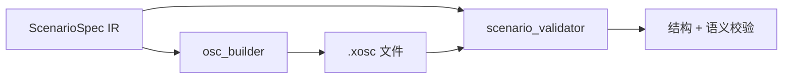
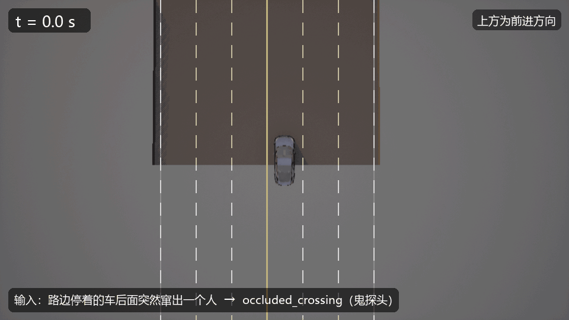
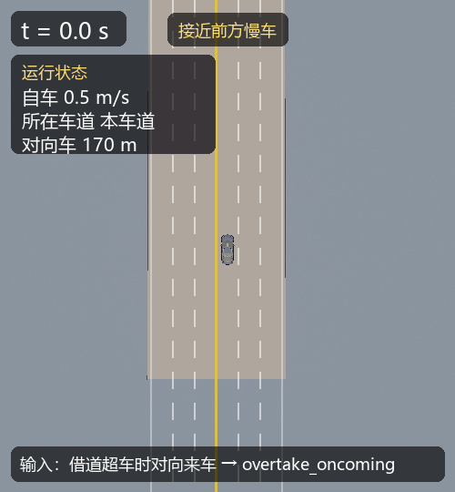
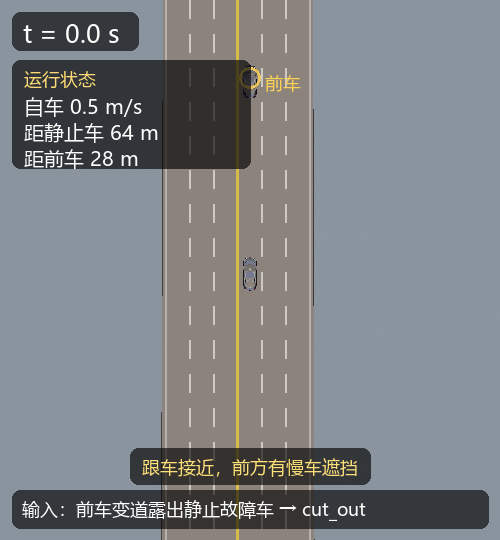
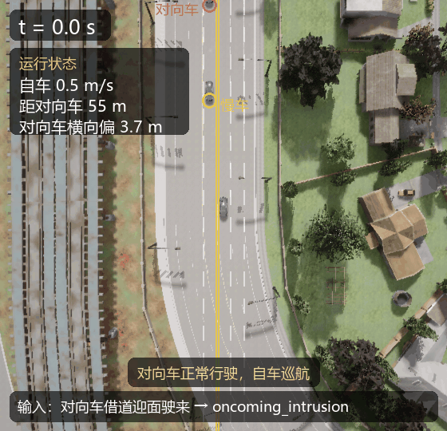

title: 场景生成

# 场景生成

把场景从硬编码代码改成**可采样、可批量、可复现**的数据。
核心是一个中间表示（IR）：`ScenarioSpec`，由它编译出 OpenSCENARIO。

## 1. 工作流程



## 2. 工具参数

### 2.1 `generate_scenario_from_template`

| 参数 | 类型 | 默认值 | 说明 |
|---|---|---|---|
| `template` | string | `cut_in` | 模板名，见第 3 节 |
| `n` | int | 1 | 生成数量 |
| `seed` | int | None | 随机种子；相同种子结果可复现 |
| `out_dir` | string | `llm/output/scenarios` | 输出目录 |
| `params_json` | string | `{}` | 覆盖模板默认参数 |

### 2.2 `validate_scenario`

| 参数 | 类型 | 默认值 | 说明 |
|---|---|---|---|
| `file_path` | string | 必填 | 待校验的 `.xosc` 文件 |

## 3. 19 个场景模板

| 模板 | 场景含义 | 实体数 | 主要触发 |
|---|---|---|---|
| `lead_brake` | 前车急刹 | 3 | 时间 |
| `lead_stationary` | 前车静止 | 2 | 时间 |
| `cut_in` | 危险切入 | 4 | 时间、时距、速度、到达 |
| `cut_in_then_brake` | 加塞后急刹 | 3 | 时间（变道、急刹分阶段） |
| `cut_out` | 前车切出遇静止车辆（AEB cut-out） | 3 | 时间、相对距离 |
| `crossing_hazard` | 行人/车辆横穿 | 2 | 时间、距离 |
| `occluded_crossing` | 鬼探头（遮挡横穿） | 3 | 时间、距离 |
| `low_overlap` | 前方低重叠率目标 | 3 | 时间、距离、速度、到达 |
| `wrong_way` | 逆行 | 2 | 时间、距离 |
| `unprotected_turn` | 路口无保护通行（需 Town10HD_Opt） | 3 | 时间、距离 |
| `merge_turn` | 路口汇入转向（需 Town10HD_Opt） | 3 | 时间、距离 |
| `dense_lane_change` | 三车道路段连续变道 | 4 | 时间 |
| `junction_light` | 路口信号冲突 | 3 | 时间、速度、距离 |
| `close_follow` | 近距跟驰（TTC 触发减速） | 2 | TTC |
| `overtake` | 超车（变道 + 相对速度） | 3 | 时间、距离、到达 |
| `overtake_oncoming` | 借道超车遇对向来车 | 3 | 时间、相对距离 |
| `oncoming_intrusion` | 对向车借道侵入本车道（需 Town03） | 3 | 时间、相对距离 |
| `evasive_swerve` | 紧急避让（轨迹跟随） | 3 | 时间 |
| `signal_phase` | 红绿灯相位（红灯等待→切绿→起步） | 2 | 信号灯、时间 |

### 3.1 鬼探头 `occluded_crossing`

本车道前方有一辆静止车辆挡住视线，行人从车尾后方窜出横穿；自车先匀速接近，
距横穿线 18 m 时线性制动，停在行人前方约 3 m。

```text
路边停着的车后面突然窜出一个人
公交车挡住视线，车头突然冒出个行人
```


<div align="center"><i>occluded_crossing：自车制动停止，行人从遮挡车尾横穿（红圈为行人，12 帧，0.5 秒/帧）</i></div>

| 参数 | 默认 | 说明 |
|---|---|---|
| `occluder_gap` | 35 m | 遮挡车与本车起点的距离 |
| `lateral` | 3.5 m | 行人起点到路中心的横向距离 |
| `ped_speed` | 1.2 m/s | 行人横穿速度 |
| `start_delay` | 1.5 s | 行人起步时刻 |
| `ego_speed` | 8 m/s | 自车接近速度 |

与 `crossing_hazard` 的区别是多了遮挡车辆，且横穿起点位于停放车辆后方，
自车的反应距离更短。

### 3.2 借道超车遇对向来车 `overtake_oncoming`

双向直路上，自车以 12 m/s 接近前方 7 m/s 的慢车，2 s 后借对向车道开始超车；
对向车道有一辆 11 m/s 的车驶来。双方距离缩到 55 m 时，自车放弃超车，
回到原车道并线性减速到慢车速度，最终跟在前车后方，无碰撞。

```text
借对向车道超车时对面有车驶来，只好放弃超车
超车到一半发现对向来车，赶紧回到原车道
```


<div align="center"><i>overtake_oncoming：借左车道超车 → 对向车接近 → 放弃超车回原车道（红圈为对向车，黄圈为慢车，11 帧）</i></div>

| 参数 | 默认 | 说明 |
|---|---|---|
| `ego_speed` | 12 m/s | 自车超车速度 |
| `lead_speed` | 7 m/s | 前方慢车速度 |
| `gap` | 45 m | 自车与慢车的初始距离 |
| `oncoming_speed` | 11 m/s | 对向车速度 |
| `oncoming_gap` | 170 m | 对向车与自车的初始距离 |
| `lc_delay` | 2.0 s | 开始借道超车的时刻 |
| `abort_gap` | 55 m | 放弃超车、回到原车道的相对距离阈值 |

触发用的是**相对距离**：`oncoming` 与自车的中心距小于 `abort_gap` 时，
同一时刻触发两个动作——自车回原车道、自车减速到 `lead_speed`。
与 `overtake` 的区别是多了对向车的存在与"放弃超车"的判定，
`overtake` 只演示变道超越，不处理会车冲突。

### 3.3 前车切出遇静止车辆 `cut_out`

双向直路上，自车以 12 m/s 跟随前方 9 m/s 的前车；前车在本车道前方 28 m 处，
再往前 36 m 停着一辆静止车辆。2.5 s 时前车向右变道让出本车道，露出静止车辆；
自车在距静止车 30 m 时线性制动到停车，最终停在静止车前约 12 m，无碰撞。

该模板对应 AEB 的 cut-out 测试：目标并非突然出现，而是被前车遮挡，
前车让开后才发现本车道正前方有静止障碍。

```text
前车突然向左变道，露出前方停着的故障车
前车切出后，本车道正前方有一辆静止车辆
```


<div align="center"><i>cut_out：前车切出让出本车道 → 露出静止车 → 自车制动停车（红圈为静止车，黄圈为前车，10 帧）</i></div>

| 参数 | 默认 | 说明 |
|---|---|---|
| `s0` | 50 m | 自车在所选车道上的起点弧长 |
| `road_id` | `1` | 路段编号，城市地图上用于指定具体道路 |
| `lane` | `-1` | 自车车道号，前车向 `lane-1` 变道 |
| `ego_speed` | 12 m/s | 自车速度 |
| `lead_speed` | 9 m/s | 前车速度 |
| `lead_gap` | 28 m | 自车与前车的初始距离 |
| `stopped_gap` | 36 m | 静止车与前车的距离 |
| `lc_delay` | 2.5 s | 前车开始切出的时刻 |
| `lc_time` | 1.6 s | 变道持续时间 |
| `brake_gap` | 30 m | 自车开始制动的相对距离阈值 |
| `brake_time` | 3.0 s | 制动到停车的时间 |

触发同样是**相对距离**：自车与 `stopped` 的中心距小于 `brake_gap` 时，
自车线性减速到 0。与 `cut_in` / `cut_in_then_brake` 的区别是冲突目标不是
变道车辆本身，而是变道后暴露出来的静止障碍；与 `lead_stationary` 的区别是
静止车辆初始被前车遮挡，自车直到前车切出后才需要响应。

**城市地图**：模板默认按生成路网的 `roadId=1 / lane=-1 / s0=50` 布景。
在 `Town03`、`Town10HD_Opt` 等内置地图上运行时，用 `road_id`、`lane`、`s0`
指定一段**同向至少两条车道、无路侧障碍的长直路**：

```text
run_scenario_in_carla(template="cut_out", map_name="Town10HD_Opt",
                      params_json='{"road_id": "12", "lane": "-1", "s0": 30}')
```

相对距离按两车中心点的直线距离计算，弯道会让"距离缩减"比沿路里程更慢，
因此城市路段应尽量平直；路段内的静态车辆、路侧停放物需要调用方自行避开。

### 3.4 对向车借道侵入本车道 `oncoming_intrusion`

城市双向路上，自车以 12 m/s 正常行驶；对向车道的来车以 12 m/s 跟在
6 m/s 的慢车后方，0.5 s 时越过中心线驶入本车道借道超车，形成迎面冲突。
自车在与来车中心距 70 m 时线性制动，来车在 45 m 时放弃借道、退回原车道
并在 2 s 内减到 5 m/s，自车停车，无碰撞。

```text
对向车借道超车，越过中心线朝我迎面开过来
对面来车占了我的车道，只能紧急刹车
对向车跑到我车道上来了
```


<div align="center"><i>oncoming_intrusion：对向车越线借道 → 自车制动 → 来车退回原车道（红圈为对向车，黄圈为慢车，11 帧）</i></div>

| 参数 | 默认 | 说明 |
|---|---|---|
| `s0` | 174 m | 自车起点弧长（固定，对应 136 m 直线段起点） |
| `road_id` | `67` | Town03 上的城市双向路段 |
| `lane` | `-1` | 自车车道号，对向车道为 `+1` |
| `ego_speed` | 12 m/s | 自车速度 |
| `slow_speed` | 6 m/s | 对向车道慢车速度 |
| `slow_gap` | 45 m | 慢车与自车的初始距离 |
| `oncoming_speed` | 12 m/s | 借道车速度 |
| `oncoming_gap` | 95 m | 借道车与自车的初始距离 |
| `lc_delay` | 0.5 s | 借道车开始越线的时刻 |
| `lc_time` | 1.2 s | 越线变道持续时间 |
| `brake_gap` | 70 m | 自车开始制动的相对距离阈值 |
| `brake_time` | 2.5 s | 制动到停车的时间 |
| `abort_gap` | 45 m | 借道车退回原车道的相对距离阈值 |
| `abort_time` | 1.2 s | 退回变道持续时间 |
| `abort_speed` | 5 m/s | 退回后减到的速度 |

触发仍是**相对距离**：自车与 `oncoming` 的中心距小于 `brake_gap` 时自车
线性制动；小于 `abort_gap` 时 `oncoming` 退回 `+1` 车道并减速。`+1` 与 `-1`
在 OpenDRIVE 中互为左邻车道，因此越线与退回都用 `delta=+1`。退回必须晚于
越线完成（`abort_gap` 对应的时刻大于 `lc_delay + lc_time`），否则车辆尚未
跨过中心线，播放器会按当前车道判定，把本车道再次当作目标车道。

与 `overtake_oncoming` 的区别：那里借道的是自车，本模板借道的是对向车；
与 `wrong_way` 的区别：逆行是长时间占用本车道，本模板只演示借道超车时的
短时越线侵入，并带退回动作。

**城市路段**：模板在 `Town03` 的 `road 67`、`s0=174` 处布景，该处向前有
约 136 m 直线无路口，`lane -1` 与 `+1` 均存在。换用其他城市地图时需要
重新确认路段（左邻车道号、直线长度、路口位置）后覆盖 `road_id`/`s0`。

## 4. 对话示例

```text
列出所有可用的场景模板
用 cut_in 模板生成一个场景，随机种子设为 42
生成 20 个前车急刹的场景，每个参数在合理范围内随机
校验刚才生成的场景文件
```

### 4.1 文字直达场景

网页聊天框输入与快捷按钮相同的文字，会先命中**本地意图表**，直接执行对应工具，
不经过大模型（离线、无 API Key 也能用）：

```text
IDM 跟驰                    -> run_scenario_in_carla(template="lead_brake", duration=18)
红绿灯相位演示              -> run_traffic_light_demo(map_name="Town03")
红绿灯模板                  -> run_scenario_in_carla(template="signal_phase", map_name="Town03")
播放 lead_brake 模板        -> run_scenario_in_carla(template="lead_brake")
在 Town04 跑匝道汇入        -> scenario_highway_ramp(ramp_type="on", map_name="Town04")
```

还可以顺带指定截图时刻、时长与红灯时长：`IDM 跟驰，截图 6,12,15`、
`红绿灯相位演示，红灯 8 秒`。模板名与按钮文字的完整对照见
[New Features 第 7 节](new-features.md#7-文字直达场景无需大模型)。

### 4.2 自然语言 → 模板 + 参数

无法确定模板时，可先调用语义解析：

```python
plan_scenario("旁边车加塞到我前面后立刻急刹")
```

```json
{"template": "cut_in_then_brake", "confidence": 0.95,
 "params": {}, "required_map": null, "needs_clarification": false}
```

`find_scenario_templates(query, top_k=3)` 额外返回候选及得分，用于判断是否存在歧义：

```text
cut_in_then_brake  9.5
cut_in             3.2
lead_brake         2.5
```

输入会先归一化（繁体、全角、语气词、单位写法），再参与匹配；
`decision` 取 `execute` / `choose` / `clarify`，分别表示直接执行、候选择一、追问澄清。

槽位、加权与歧义判定的细节见
[New Features](new-features.md#2026-11--自然语言场景生成)。

## 5. 代码示例

### 5.1 批量生成

```python
from scenario_templates import build
from osc_builder import write_scenario

# 同一个模板 + 不同种子 = 参数区间内的不同场景，结构一致
for seed in range(20):
    spec = build("lead_brake", seed=seed)
    write_scenario(spec, "output/lead_brake_%02d.xosc" % seed)
```

### 5.2 覆盖参数

```python
spec = build("cut_in", seed=1, params={"delay": 3.0, "gap": 12.0})
```

### 5.3 指纹去重

```python
from scenario_ir import ScenarioSpec

seen = set()
for seed in range(100):
    spec = build("cut_in", seed=seed)
    fp = spec.fingerprint()          # 场景结构性指纹
    if fp in seen:
        continue                      # 重复场景跳过
    seen.add(fp)
```

## 6. ScenarioSpec 字段

| 字段 | 说明 |
|---|---|
| `entities` | 实体列表（车辆/行人），含初始位置与速度 |
| `behaviors` | 行为列表（26 类，如变速、变道、跟驰） |
| `triggers` | 触发列表（10 类，如时间、距离、时距） |
| `fingerprint()` | 场景指纹，用于批量去重 |

## 7. 校验内容

| 层次 | 检查项 |
|---|---|
| 结构 | 用 `scenariogeneration` 往返解析，确认 XML 合法 |
| 语义 | 实体数量、车道有效性、速度范围、触发可达性等 8 项 |

### 输出示例

```text
✅ 场景校验通过
   文件：llm/output/scenarios/cut_in_0000.xosc
   实体：4 个（3 车辆 + 1 行人）
   行为：5 个
   触发：4 个
   统计：时长 30.0s，最大速度 13.0 m/s
```

## 8. OpenSCENARIO 版本

默认输出 **OSC 1.1**，可指定 1.0 / 1.1 / 1.2 / 1.3：

```python
write_scenario(spec, "out.xosc", osc_minor_version=2)
```

| 版本 | 差异 |
|---|---|
| 1.0 | 目标速度标签为 `AbsoluteSpeed` |
| 1.1+ | 目标速度标签为 `AbsoluteTargetSpeed`，支持 `override` |

> 若播放器只支持 1.0，需要改默认值并补行人 `model` 定义。

## 9. 实测

| 项目 | 结果 |
|---|---|
| OSC 生成器往返解析 | 4 场景 × 4 版本 = **16/16 通过** |
| 模板编译与校验 | **16/16 通过**，同 seed 指纹一致 |
| 批量生成 | 50 个 **6.86 s**，80 个混合 **10.89 s**，重复 0 |
