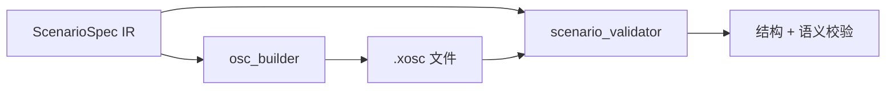

title: 场景生成

# 场景生成

把场景从硬编码代码改成**可采样、可批量、可复现**的数据。
核心是一个中间表示（IR）：`ScenarioSpec`，由它编译出 OpenSCENARIO。

## 1. 工作流程



## 2. 工具参数

### 2.1 `generate_scenario_from_template`

| 参数 | 类型 | 默认值 | 说明 |
|---|---|---|---|
| `template` | string | `cut_in` | 模板名，见第 3 节 |
| `n` | int | 1 | 生成数量 |
| `seed` | int | None | 随机种子；相同种子结果可复现 |
| `out_dir` | string | `llm/output/scenarios` | 输出目录 |
| `params_json` | string | `{}` | 覆盖模板默认参数 |

### 2.2 `validate_scenario`

| 参数 | 类型 | 默认值 | 说明 |
|---|---|---|---|
| `file_path` | string | 必填 | 待校验的 `.xosc` 文件 |

## 3. 11 个场景模板

| 模板 | 场景含义 | 实体数 | 主要触发 |
|---|---|---|---|
| `lead_brake` | 前车急刹 | 3 | 时间、时距、静止 |
| `lead_stationary` | 前车静止 | 2 | 时间 |
| `cut_in` | 危险切入 | 4 | 时间、时距、速度、到达 |
| `crossing_hazard` | 行人/车辆横穿 | 2 | 时间、距离 |
| `low_overlap` | 前方低重叠率目标 | 3 | 时间、距离、速度、到达 |
| `wrong_way` | 逆行 | 2 | 时间、距离 |
| `unprotected_turn` | 路口无保护通行 | 3 | 时间、距离 |
| `junction_light` | 路口信号冲突 | 3 | 时间、速度、距离 |
| `close_follow` | 近距跟驰（TTC 触发减速） | 2 | TTC |
| `overtake` | 超车（变道 + 相对速度） | 3 | 时间、距离、到达 |
| `evasive_swerve` | 紧急避让（轨迹跟随） | 3 | 时间 |

## 4. 对话示例

```text
列出所有可用的场景模板
用 cut_in 模板生成一个场景，随机种子设为 42
生成 20 个前车急刹的场景，每个参数在合理范围内随机
校验刚才生成的场景文件
```

## 5. 代码示例

### 5.1 批量生成

```python
from scenario_templates import build
from osc_builder import write_scenario

# 同一个模板 + 不同种子 = 参数区间内的不同场景，结构一致
for seed in range(20):
    spec = build("lead_brake", seed=seed)
    write_scenario(spec, "output/lead_brake_%02d.xosc" % seed)
```

### 5.2 覆盖参数

```python
spec = build("cut_in", seed=1, params={"delay": 3.0, "gap": 12.0})
```

### 5.3 指纹去重

```python
from scenario_ir import ScenarioSpec

seen = set()
for seed in range(100):
    spec = build("cut_in", seed=seed)
    fp = spec.fingerprint()          # 场景结构性指纹
    if fp in seen:
        continue                      # 重复场景跳过
    seen.add(fp)
```

## 6. ScenarioSpec 字段

| 字段 | 说明 |
|---|---|
| `entities` | 实体列表（车辆/行人），含初始位置与速度 |
| `behaviors` | 行为列表（26 类，如变速、变道、跟驰） |
| `triggers` | 触发列表（10 类，如时间、距离、时距） |
| `fingerprint()` | 场景指纹，用于批量去重 |

## 7. 校验内容

| 层次 | 检查项 |
|---|---|
| 结构 | 用 `scenariogeneration` 往返解析，确认 XML 合法 |
| 语义 | 实体数量、车道有效性、速度范围、触发可达性等 8 项 |

### 输出示例

```text
✅ 场景校验通过
   文件：llm/output/scenarios/cut_in_0000.xosc
   实体：4 个（3 车辆 + 1 行人）
   行为：5 个
   触发：4 个
   统计：时长 30.0s，最大速度 13.0 m/s
```

## 8. OpenSCENARIO 版本

默认输出 **OSC 1.1**，可指定 1.0 / 1.1 / 1.2 / 1.3：

```python
write_scenario(spec, "out.xosc", osc_minor_version=2)
```

| 版本 | 差异 |
|---|---|
| 1.0 | 目标速度标签为 `AbsoluteSpeed` |
| 1.1+ | 目标速度标签为 `AbsoluteTargetSpeed`，支持 `override` |

> 若播放器只支持 1.0，需要改默认值并补行人 `model` 定义。

## 9. 实测

| 项目 | 结果 |
|---|---|
| OSC 生成器往返解析 | 4 场景 × 4 版本 = **16/16 通过** |
| 模板编译与校验 | **8/8 通过**，同 seed 指纹一致 |
| 批量生成 | 50 个 **6.86 s**，80 个混合 **10.89 s**，重复 0 |
