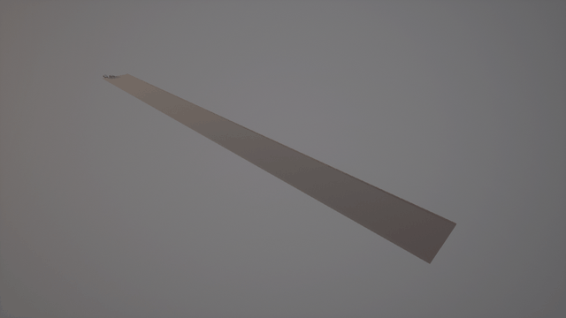
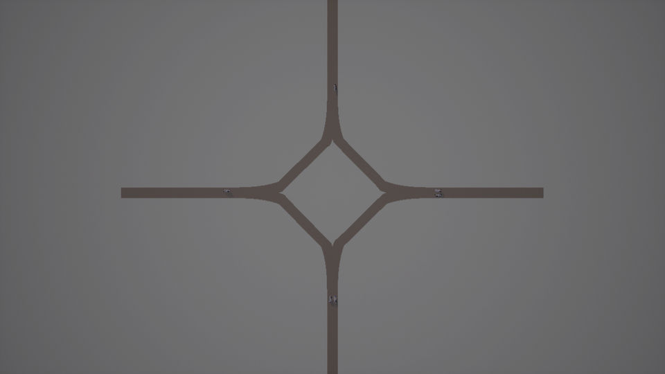
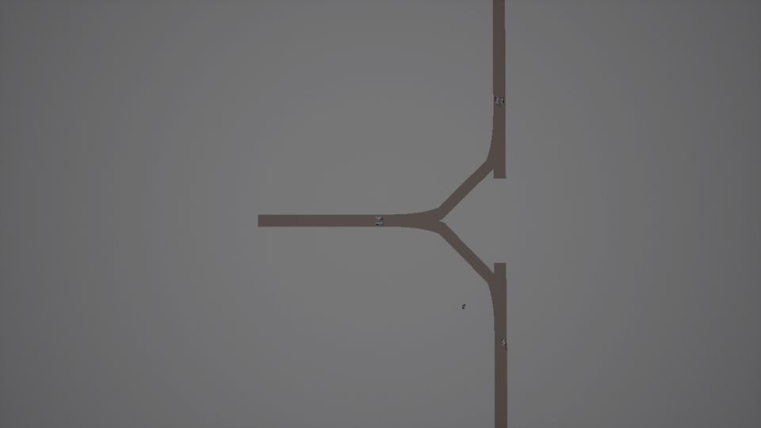
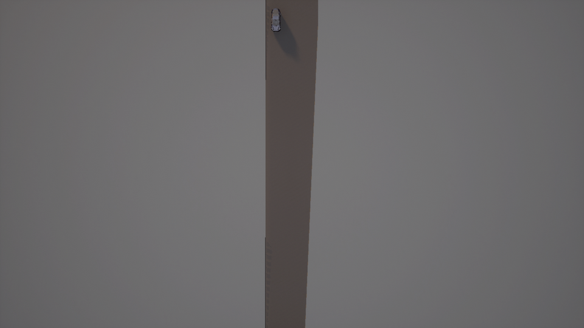
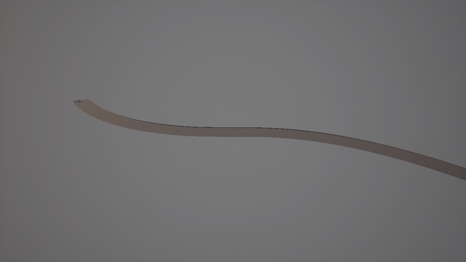
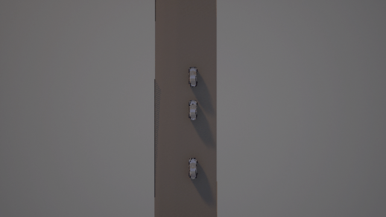
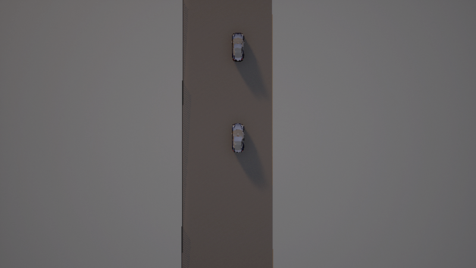
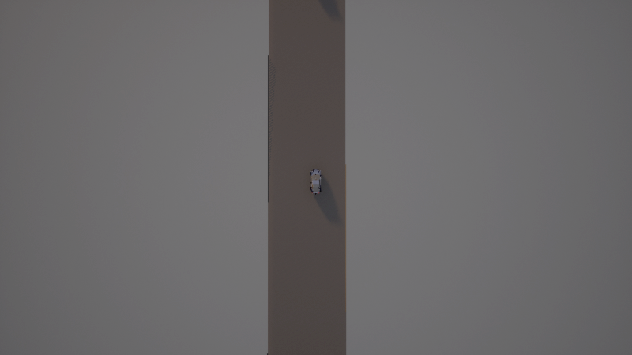
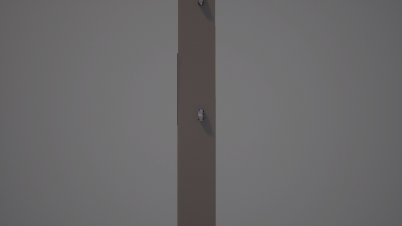

title: 新增特性

# 新增特性：场景生成、路网生成与 CARLA 执行

本次新增三组能力，目标是解决两个问题：**场景生成效率**和**基于实采有限数据生成批量合成数据**。

| 能力 | 解决的问题 |
|---|---|
| 参数化场景生成（OpenSCENARIO） | 原来只会生成"一辆车匀速直行"，没有中间表示，无法批量 |
| 参数化路网生成（OpenDRIVE） | 原来唯一的 xodr 出自 netconvert 规则网格，没有几何 |
| 场景执行与截图 | 生成的 `.xosc` 无法播放，无法验证"跑起来是什么样" |
| 实采轨迹批量合成 | 少量真实轨迹扩增为大批量合成数据，并做分布校验 |

---

## 1. 环境配置

### 1.1 基础环境

| 项目 | 版本 | 说明 |
|---|---|---|
| Python | 3.10 | CARLA PythonAPI 的 wheel 只提供到 3.10 |
| CARLA | 0.9.16 | `carla==0.9.16` |
| 操作系统 | Windows 10 / 11 | CARLA 服务端只在这里跑 |

### 1.2 安装 Python 依赖

```bash
cd mcp
pip install -r llm/requirements.txt
```

关键新增依赖：

```text
scenariogeneration>=0.16.0    # OpenSCENARIO / OpenDRIVE 对象模型
lxml>=5.0.0                   # XSD 校验
carla==0.9.16                 # CARLA 客户端
```

> `scenariogeneration` 在库内是**延迟导入**的，缺失时不影响 MCP 服务启动，
> 只有调用场景/路网相关工具时才会报错。

### 1.3 配置 DeepSeek API Key

在项目根目录创建 `.env`：

```text
DEEPSEEK_API_KEY=sk-xxxxxxxxxxxxxxxx
```

### 1.4 启动 CARLA

用无界面模式启动（省显存，适合服务器/集显机器）：

```bat
cd D:\CARLA_0.9.16
CarlaUE4.exe -RenderOffScreen -quality-level=Low -nosound -carla-port=2000
```

成功标志：进程 `CarlaUE4-Win64-Shipping` 存在，端口 2000 处于监听状态。

也可以在对话里直接问「CARLA 连上了吗」，会调用 `list_carla_maps` 返回服务端版本与可用地图列表。

### 1.5 启动 MCP 服务

```bat
mcp.bat
```

或手动：

```bash
python llm/main_ai.py
```

浏览器打开 `http://127.0.0.1:3000`，页面顶部的「场景快捷按钮」面板可以不输入文字直接执行场景。

---

## 2. 提示词示例

### 2.1 生成 OpenSCENARIO 场景

```text
列出所有可用的场景模板
用 cut_in 模板生成一个场景，随机种子设为 42
生成 20 个前车急刹的场景，每个参数在合理范围内随机
校验刚才生成的场景文件
```

### 2.2 生成路网

```text
列出所有路网布局
生成一个十字路口路网
生成一个匝道合流路网，主路 4 车道、匝道 2 车道
```

### 2.3 把生成的场景跑进 CARLA

```text
把十字路口路网加载进 CARLA 并截图
在 CARLA 里播放 cut_in 场景，第 2 秒和第 5 秒各截一张图
把 wrong_way 场景跑 6 秒看看效果
```

### 2.4 实采轨迹批量合成

```text
导入 _traj_samples 里的轨迹数据
基于这些轨迹合成 100 条数据
对比合成数据和真实数据的分布
把轨迹导出成 SUMO 的需求文件
```

---

## 3. 效果演示

### 3.1 路网生成：7 种布局全部可加载

下面 6 种布局全部由本项目生成的 `.xodr` 在 CARLA 0.9.16 中渲染，**不是导入的现成地图**。


<div class="div" style="text-align: center">
<i>6 种路网布局在 CARLA 中的实际渲染（动图）</i>
</div>

| 布局 | 文件大小 | 道路数 | 几何段数 | 生成点 |
|---|---|---|---|---|
| 直路 | 2626 B | 1 | 1 | 2 |
| 高速弯道 | 3071 B | 1 | 1 | 2 |
| S 弯 | 3694 B | 1 | 1 | 2 |
| 十字路口 | 22708 B | 12 | 28 | 12 |
| 丁字路口 | 17023 B | 9 | 21 | 9 |
| 匝道合流 | 4195 B | 1 | 1 | 4 |
| 匝道分流 | 3496 B | 1 | 1 | 3 |

#### 十字路口


<div class="div" style="text-align: center">
<i>4 条臂 + 菱形路口环，6 辆车已布景</i>
</div>

#### 丁字路口


<div class="div" style="text-align: center">
<i>东西横杠 + 朝南竖杠</i>
</div>

#### 匝道合流


<div class="div" style="text-align: center">
<i>车道数 1→2（s=0 左1右1 → s=80 左1右2）</i>
</div>

#### S 弯


<div class="div" style="text-align: center">
<i>两段反向曲线，中间带缓和曲线</i>
</div>

### 3.2 场景执行：8 个模板全部可播放

播放器会解析 `.xosc` 的实体、触发条件与动作，按仿真时间驱动车辆并截图。


<div class="div" style="text-align: center">
<i>cut_in（危险切入）在直路上播放 8 秒：后车跟随、切入车变道（动图，0.5 秒/帧）</i>
</div>

| 模板 | 场景含义 | 实体 | 触发事件 | 未支持项 |
|---|---|---|---|---|
| `lead_stationary` | 前车静止 | 2 | 1/1 | 0 |
| `wrong_way` | 逆行 | 2 | 2/2 | 0 |
| `crossing_hazard` | 行人横穿 | 2 | 2/2 | 0 |
| `junction_light` | 路口信号 | 3 | 3/3 | 0 |
| `lead_brake` | 前车急刹 | 3 | 3/4 | 0 |
| `low_overlap` | 低重叠目标 | 3 | 4/4 | 0 |
| `unprotected_turn` | 无保护通行 | 3 | 4/4 | 0 |
| `cut_in` | 危险切入 | 4 | 4/5 | 0 |

#### 前车急刹


<div class="div" style="text-align: center">
<i>t=4.0 s：前车已停住，后车按跟驰动作减速</i>
</div>

#### 无保护通行


<div class="div" style="text-align: center">
<i>t=4.0 s</i>
</div>

#### 低重叠目标


<div class="div" style="text-align: center">
<i>t=4.0 s</i>
</div>

### 3.3 场景生成：一份配置生成多个变体

同一个模板配合不同的随机种子，会得到参数区间内的不同场景，但结构一致：

```python
from scenario_templates import build
from osc_builder import write_scenario

for seed in range(20):
    spec = build("lead_brake", seed=seed)      # 前车速度、间距、刹车时刻都在区间内随机
    write_scenario(spec, "output/lead_brake_%02d.xosc" % seed)
```

批量生成 50 个场景约 6.9 秒，且不会产生重复场景（用指纹去重）。

---

## 4. 实测数据

| 项目 | 结果 |
|---|---|
| OSC 生成器往返解析 | 4 场景 × 4 版本 = **16/16 通过** |
| 场景模板 | **8/8** 编译与校验通过，同 seed 指纹一致 |
| 批量场景 | 50 个 **6.86 s**，80 个混合 **10.89 s**，重复 0 |
| 路网布局 | **7/7** 生成并通过几何校验 |
| CARLA 加载 | **7/7** 成功，每种约 7 秒（含 2 秒世界加载） |
| 场景播放 | **8/8** 模板跑通，未支持项 0 |
| 轨迹导入 | CSV / FCD / JSON **三种格式全部通过** |
| 批量合成 | 100 条 **0.17 s**（595 条/秒），100/100 成功 |
| 分布对比 | 速度 KS 距离 **0.029** |

---

## 5. 已知限制

### 5.1 播放器是子集实现

不支持的条件与动作会记入 `unsupported` 并明确返回，**不会静默跳过**：

- 条件：`CollisionCondition`、`TimeToCollisionCondition`、`RelativeSpeedCondition`、`AccelerationCondition`
- 动作：`FollowTrajectoryAction`、`Story` 分支、`Catalog`、`TrafficSignalControllerAction`

跟驰用 P 控制、变道用纯追踪，都没做加速度约束；`freespace` / `alongroute` 按直线距离处理。

### 5.2 路口环是折线拼接

`CommonJunctionCreator` 用直线连接各臂端点，十字路口呈现为**菱形环**而不是正方形环。拓扑正确、可通行，但几何不是真实交叉口的样子。

### 5.3 CARLA 客户端断言

一次进程内连续切换多个世界会偶发 `_episode != nullptr` 断言（引擎侧问题）。目前的规避方式是每种布局跑独立进程。

### 5.4 测试环境

集显 + `-quality-level=Low` 下完成，未在独立显卡 / 高画质复验。

### 5.5 轨迹数据

当前没有真实车队数据，测试用符合 NGSIM 格式的合成样本（3 条 / 180 帧 / 10 Hz）。拿到实采数据后需要重跑分布对比确认增强强度是否合适。
